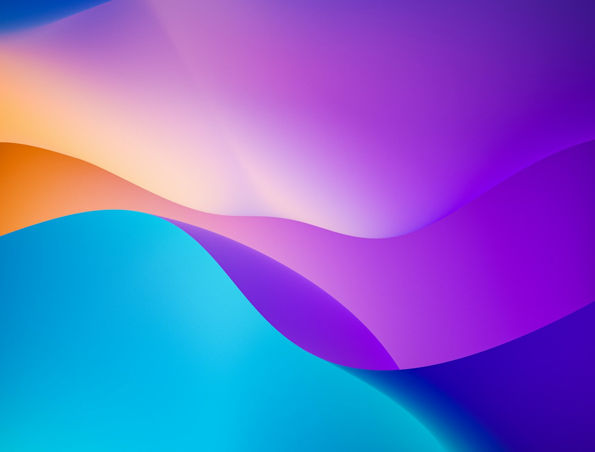

# MARCUS VANCE STUDIO (`MV`)

**Interactive Creative Developer Portfolio — Locked 100vh Counter-Rotating Twin-Wheel Stage, Live Telemetry HUD & `⌘K` Command Palette**

  
  

  
  
  
  
  

 

**[Launch Live Demo](https://annoris.github.io/marcus-vance-studio/)** · **[Twin-Wheel Architecture](#-core-architecture--features)** · **[Design System](#-obsidian-slate--glacial-cobalt-design-system)** · **[Commercial License & Source Access](#-commercial-license--full-clean-source-access)**

---

## About Marcus Vance Studio (`MV`)

**Marcus Vance Studio (`MV`)** is an interactive, kinetic portfolio and design-engineering showcase built for a London-based creative developer and studio founder. Instead of a traditional scrolling webpage, the entire experience lives inside a **locked `100vw × 100vh` viewport stage** driven by a counter-rotating twin-wheel navigation engine, real-time telemetry HUD, live multiplayer presence cursors, and a keyboard-first `⌘K` Command Palette.

Engineered with **pure HTML5, CSS3, and Vanilla ES6 JavaScript**, it delivers 60fps tactile motion with **zero build tools and zero external runtime dependencies**.

### Key Highlights

- **Signature Counter-Rotating Twin-Wheel Stage**: Locked `100vw × 100vh` canvas with smooth inertial wheel, pointer drag, and keyboard arrow navigation.
- **Live Telemetry HUD**: Real-time London clock (`LDN::`), live `FPS` monitor, `LCP` metric, `ONLINE` counter, `PRESENCE::ON/OFF` toggle, and `BOOKING` status chip.
- **Multiplayer Presence & `⌘K` Command Palette**: Ambient floating peer cursors with presence toast notifications, plus an instant keyboard-driven command palette (`⌘K` / `Ctrl+K`) to jump to any project, drawer, or theme.
- **12 Curated Projects + 6 Slide-Over Drawers**: Custom geometric SVG emblems, high-contrast case-study cards, and slide-over drawers (`About`, `Lab`, `Writing`, `Studio`, `Contact`, `What's new`).

---

## Core Architecture & Features

- **Locked `100vw × 100vh` Twin-Wheel Stage**: Dual counter-rotating radial wheels—one displaying tactile project tiles with custom geometric emblems, and the paired stage presenting full-bleed project artwork and metadata. Supports mouse wheel, touch/pointer drag, and `↑ / ↓ / ← / →` keyboard navigation.
- **Live Telemetry HUD (`96px` 2-Tier Header)**:
  - `LDN::` real-time London GMT/BST clock
  - Live `FPS::` frame-rate readout via `requestAnimationFrame`
  - `LCP::` Largest Contentful Paint performance readout
  - `ONLINE::` active visitors indicator & `PRESENCE::ON` cursor toggle
  - `BOOKING::` direct trigger into the Contact & Booking drawer
- **Live Presence Cursors & Toast**: Smoothly animated ambient peer cursors gliding across the canvas (`pointer-events: none`), paired with non-intrusive presence toast notifications and one-click toggle.
- **`⌘K` Command Palette**: Instant fuzzy-style quick-switcher for all 12 projects, all 6 studio drawers, Dark/Light theme toggle, and presence controls.
- **12 Curated Projects & Custom Geometric Emblems**: Every project features a bespoke geometric SVG mark, discipline tags, year, interactive preview card, and detailed case-study drawer.
- **6 Slide-Over Studio Drawers**: Seamless glassmorphic drawers for **About**, **Lab**, **Writing**, **Studio**, **Contact**, and **What's new**—with keyboard `Escape` dismissal and backdrop blur.

---

## Obsidian Slate & Glacial Cobalt Design System

### Color Tokens — Dark Default & Cool Stone Paper Light Mode

| Swatch | Token | Dark (`Obsidian Slate`) | Light (`Cool Stone Paper`) | Role |
| :---: | :--- | :--- | :--- | :--- |
|  | `--bg` | `#141619` | `#E4E6E9` | Primary locked viewport canvas |
|  | `--surface-solid` | `#1C1F24` | `#F4F5F7` | Cards, drawers & command palette |
|  | `--text` | `#F3F5F8` | `#141619` | Primary editorial typography |
|  | `--text-muted` | `#98A1AE` | `#525965` | Secondary metadata & labels |
|  | `--accent` | `#4F9CF9` | `#2F7DE1` | Glacial Cobalt — active states & focus |

### Typography

- **Display & UI Sans**: `Geist` / `Inter` (`-apple-system`, `BlinkMacSystemFont`, `Segoe UI`, `sans-serif`)
- **Telemetry & Micro-Labels**: `Geist Mono` / `JetBrains Mono` (`ui-monospace`, `SFMono-Regular`, `Menlo`, `monospace`)

---

## Commercial License & Full Clean Source Access

Explore the full interactive experience right now via the official **[Live Demo](https://annoris.github.io/marcus-vance-studio/)**.

> **Proprietary License Notice:** Copyright © 2026 Annoris / Marcus Vance Studio. **All Rights Reserved.** Copying, cloning, redistributing, or using this codebase for personal or commercial projects without a verified license is strictly prohibited. See [LICENSE](LICENSE) for full terms.

### Unlock Full Clean, Unminified Source Code + Commercial License

To obtain a **commercial license** and receive the **full clean, unminified source package** (including all 12 projects, custom geometric SVG emblems, twin-wheel physics engine, Dark/Light design tokens, and `DESIGN_SPEC.md`):

1. **Send a contribution via Solana (`SOL`)** to the official wallet below.
2. **Send your Solana transaction hash + GitHub username** via GitHub Issues or direct contact to verify your contribution and unlock full commercial source access.

| Network | Wallet Address |
| :--- | :--- |
| **Solana (`SOL`)** | `3HvUMCUSSHEdtA35UuD4J7mbgpTxJ7LgT2X7GfdzvBdm` |

 

> **Warning:** Only send **SOL** on the **Solana network** to this wallet address. Sending tokens on any other network may result in permanent loss of funds.

---

  © 2026 Annoris / Marcus Vance Studio — All Rights Reserved. Explore the <a href="https://annoris.github.io/marcus-vance-studio/">Live Demo</a>.

